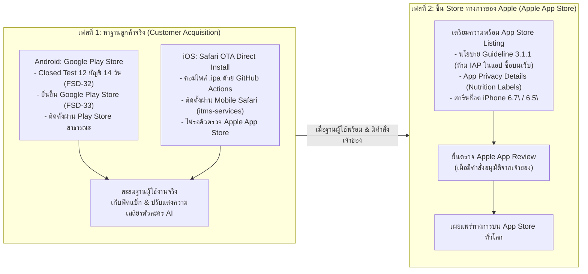

# แผนการส่งมอบและโรดแมปการปล่อยแอป (Phased Release & Delivery Roadmap)
**Project:** `live` (Member App) — `com.livezala.app`  
**Company:** Full Stack Development  
**Directing Principle:** คำสั่งเจ้าของ — *\"หาฐานลูกค้าก่อน ขึ้น Store จริงของ Apple ทีหลัง\"*

---

## 1. ลำดับเฟสการปล่อยแอป (Phased Sequencing)

---

## 2. รายละเอียดการดำเนินการแต่ละเฟส

### เฟสที่ 1: การสะสมฐานผู้ใช้จริง (Active Phase)

#### 1. ฝั่ง Android:
- **ไฟล์ส่งมอบ:** `app-release.aab` (ขนาด ~39 MB)
- **ช่องทาง:** Google Play Store
- **ขั้นตอนการปล่อย:**
  1. ทดสอบแบบปิด (Closed Testing) กับสมาชิก 12 บัญชีเป็นเวลา 14 วัน (ฝ่าย QA - FSD-32)
  2. จัดเตรียมหน้า Store Listing (ฝ่าย Play Console - FSD-33)
  3. ขออนุมัติจากเจ้าของก่อนเปิดเผยแพร่ (Production)
- **จุดเด่น:** ผู้ใช้ Android ดาวน์โหลดและอัปเดตผ่าน Google Play ได้อย่างสะดวกสบาย

#### 2. ฝั่ง iOS:
- **ไฟล์ส่งมอบ:** `live-app-release.ipa` + `manifest.plist` + `index.html`
- **ช่องทาง:** Mobile Safari Over-The-Air (Safari OTA)
- **ขั้นตอนการปล่อย:**
  1. รัน GitHub Actions Workflow (`.github/workflows/ios-build.yml`) บน macOS Runner
  2. โฮสต์ไฟล์ `.ipa` และ `manifest.plist` บนเซิร์ฟเวอร์ HTTPS (`livezala.com/mobileapp/`)
  3. กระจายลิงก์หน้าติดตั้ง `https://livezala.com/mobileapp/` ให้ผู้ใช้เปิดผ่าน Safari บน iPhone
  4. ผู้ใช้กดติดตั้งผ่านโปรโตคอล `itms-services://` และกด Trust Certificate ใน Settings
- **จุดเด่น:** 
  - เข้าถึงผู้ใช้ iOS ได้ทันทีในวันแรก
  - หลีกเลี่ยงความล่าช้าในการตรวจสอบกฎ In-App Purchase (IAP) ของ Apple Reviewer ระหว่างช่วงเริ่มต้นธุรกิจ
  - อัปเดตเวอร์ชันใหม่ได้รวดเร็วเพียงแค่อัปโหลดไฟล์ `.ipa` ใหม่ขึ้นเซิร์ฟเวอร์

---

### เฟสที่ 2: การขึ้น Apple App Store ทางการ (Future Phase)

- **เกณฑ์การเริ่มเฟส 2:**
  1. ฐานผู้ใช้งาน Android และ iOS (OTA) มีการเติบโตอย่างมั่นคง
  2. โค้ดระบบตัวละคร ฟีด และ DM ได้รับการพิสูจน์แล้วว่าไร้ข้อผิดพลาด
  3. มีคำสั่งอนุมัติโดยตรงจากเจ้าของโครงการ
- **สิ่งที่ต้องเตรียมสำหรับการยื่นตรวจ App Store:**
  1. บัญชี Apple Developer Program (Organization Account)
  2. การตรวจสอบตาม Apple Review Guideline 3.1.1 (Business Model & IAP):
     - แอป Livezala เป็นโซเชียลตัวละคร AI ที่ไม่มีปุ่มชำระเงินหรือ IAP ภายในแอป (เครดิตเติมผ่านเว็บ livezala.com) ต้องชี้แจงว่าเป็น Reader/Multiplatform Utility Account
  3. ข้อกำหนดด้านความปลอดภัยของเนื้อหา (Guideline 1.2 User-Generated Content):
     - ระบบรายงานครบ 10 ครั้งซ่อนอัตโนมัติ (พร้อมใช้งานแล้วใน v1)
     - ระบบบล็อกผู้ใช้และตัวละคร (พร้อมใช้งานแล้วใน v1)
     - ตัวกรองคำส่วนตัว (พร้อมใช้งานแล้วใน v1)
     - นโยบายและปุ่มขอลบบัญชี `https://livezala.com/delete-account` (พร้อมใช้งานแล้วใน v1)

---

## 3. สรุปความพร้อมของทีม Front-End

| ส่วนงาน | สถานะ | ตำแหน่งไฟล์ / เอนด์พอยต์ |
| :--- | :--- | :--- |
| **Android App Bundle (AAB)** | ✅ พร้อม 100% | `F:/livezala-app/android/app/build/outputs/bundle/release/app-release.aab` |
| **iOS GitHub Actions Workflow** | ✅ พร้อม 100% | `.github/workflows/ios-build.yml` |
| **iOS Safari OTA Manifest** | ✅ พร้อม 100% | `ios/ota/manifest.plist` |
| **iOS Safari Landing Page** | ✅ พร้อม 100% | `ios/ota/index.html` |
| **iOS ExportOptions Presets** | ✅ พร้อม 100% | `ios/ExportOptions.plist` |
| **TypeScript Codebase** | ✅ 0 errors | `npx tsc --noEmit` ผ่าน 100% |
| **UI/UX Spec & Rules** | ✅ สมบูรณ์ | สเปก 4 แท็บ, กฎ @live, กฎ DM Mutual, กฎ 10 Reports |
| **Build & Deploy Guides** | ✅ สมบูรณ์ | `BUILD.md`, `IOS_SAFARI_OTA_GUIDE.md`, `RELEASE_ROADMAP_PHASED.md` |
